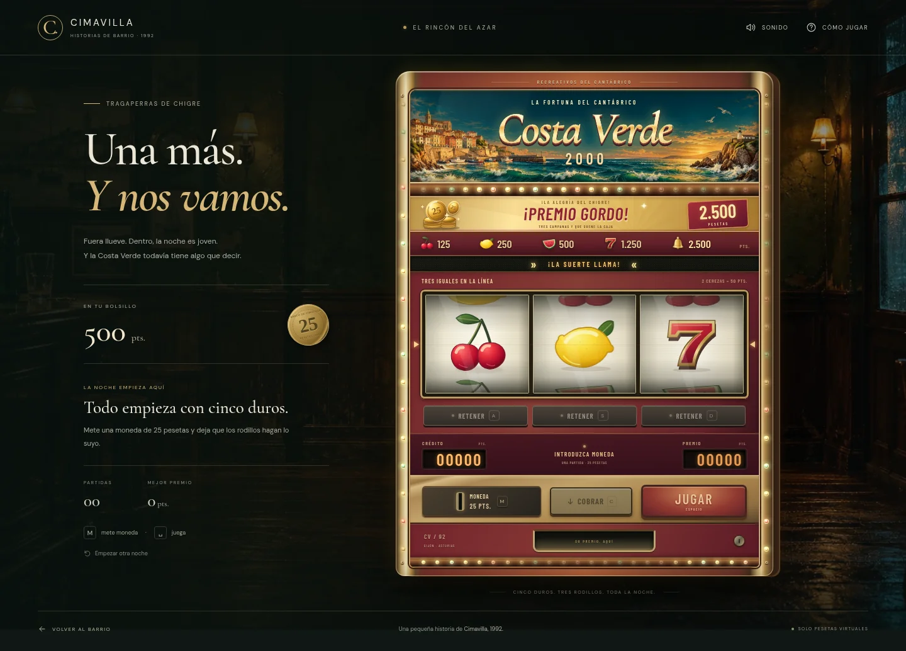

# minijuegos-cimavilla
Prototipos web de minijuegos · Cimavilla 1992

**Costa Verde 2000** estrena una máquina de chigre con arte propio, rodillos mecánicos, sonido, retenciones, avances y guardado. [Instrucciones, pruebas e integración con Unity](tragaperras/README.md).

Para jugar localmente: `python -m http.server 4173` y abrir `http://localhost:4173/tragaperras/`.

