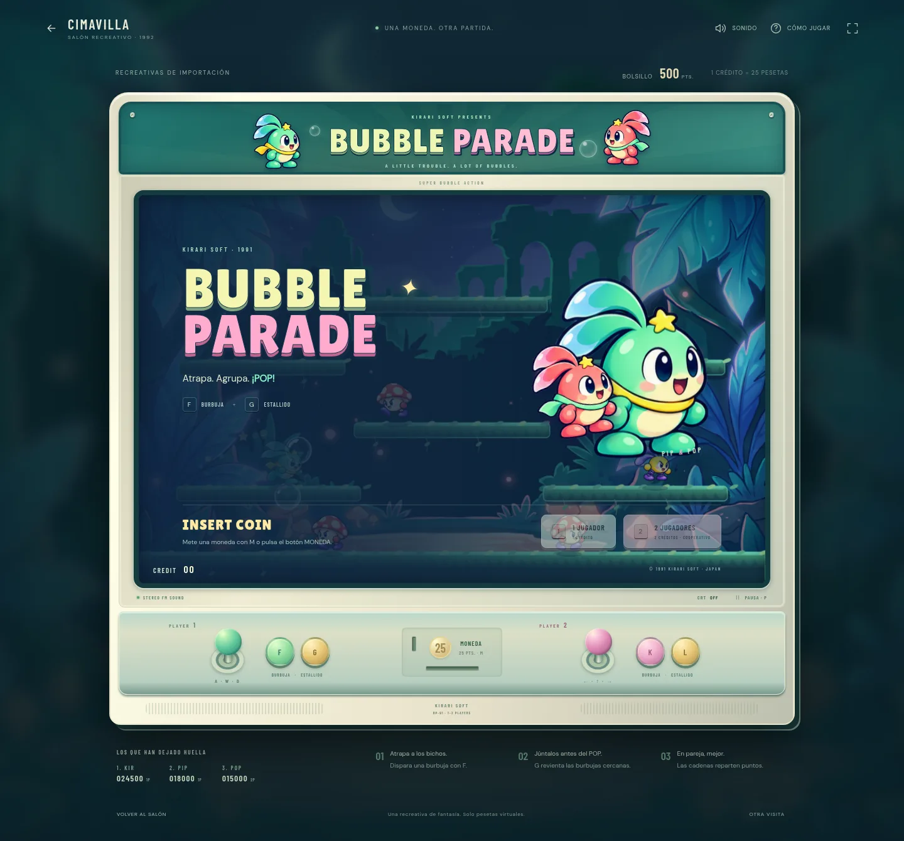

# minijuegos-cimavilla
Prototipos web de minijuegos · Cimavilla 1992

**Costa Verde 2000** estrena una máquina de chigre con arte propio, rodillos mecánicos, sonido, retenciones, avances y guardado. [Instrucciones, pruebas e integración con Unity](tragaperras/README.md).

**Bubble Parade** rehace Burbujas como una recreativa de Kirari Soft, fabricante ficticio japonés de 1991: sprites propios, seis fases en tres mundos, cadenas, cooperativo y música FM original. [Jugar, controles y pruebas](burbujas/README.md).

Para jugar localmente: `python -m http.server 4173` y abrir `http://localhost:4173/burbujas/` o `http://localhost:4173/tragaperras/`.

[Paquete nativo de Costa Verde para Unity 6 URP](unity/README.md): motor C#, recursos, Input System y generador de escena/prefab. Las recreativas tienen mundos y fabricantes ficticios propios; véase el [orden de trabajo](docs/SIGUIENTE_MINIJUEGO.md).

[Recursos y contrato de Bubble Parade para Unity 6 URP](burbujas/UNITY_PORT.md). El próximo proyecto será el [beat ’em up](docs/BRIEF_BEAT_EM_UP.md), seguido de Pong.

